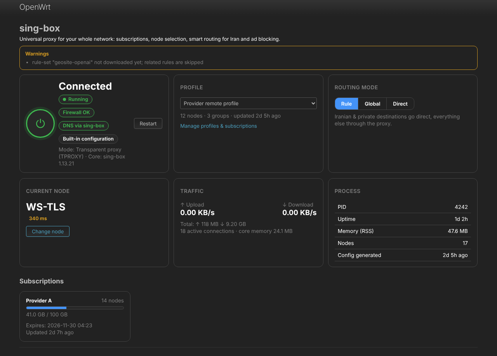
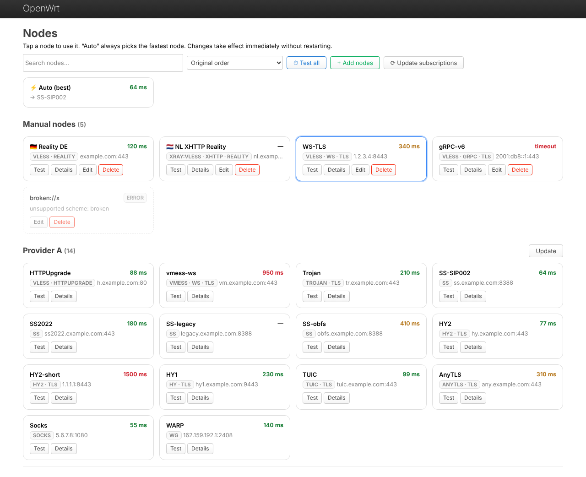
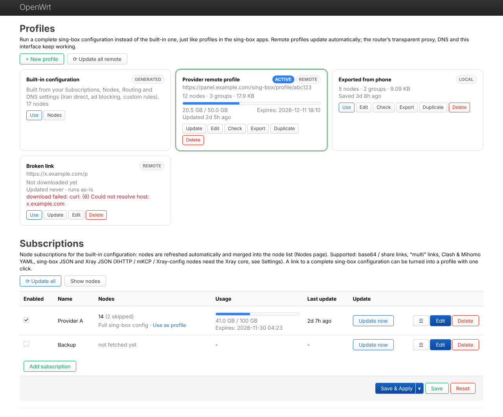
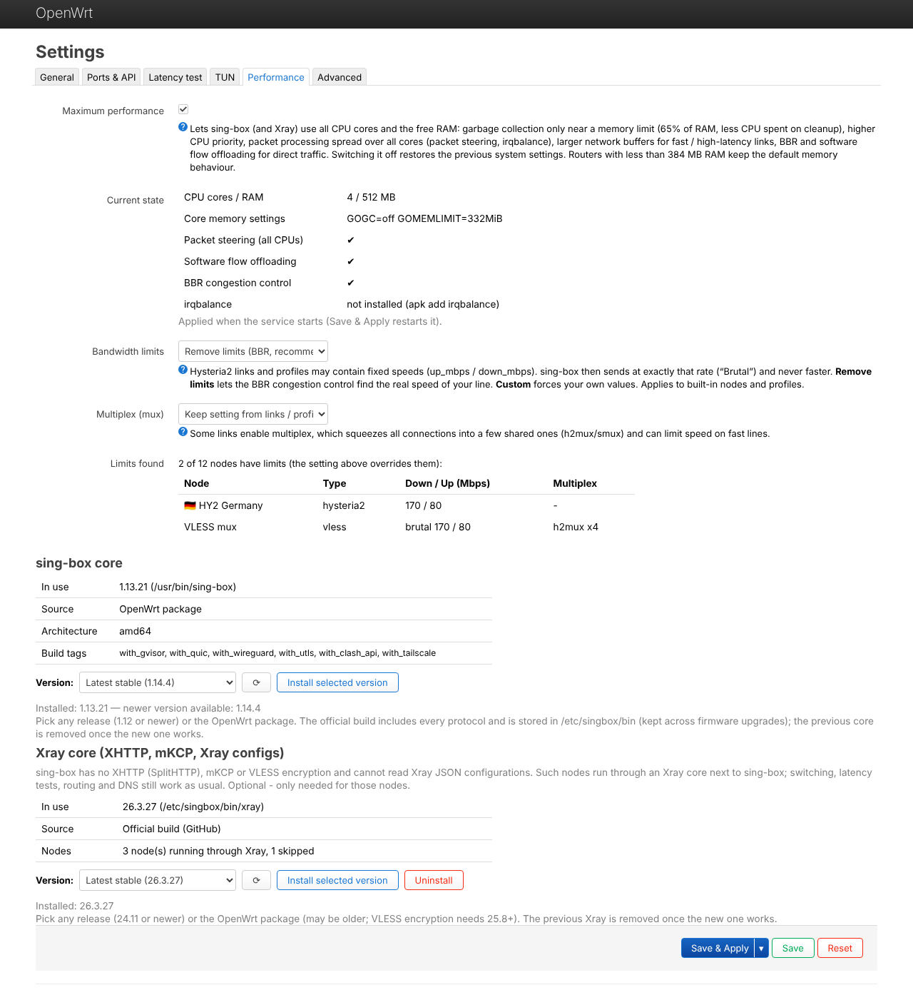
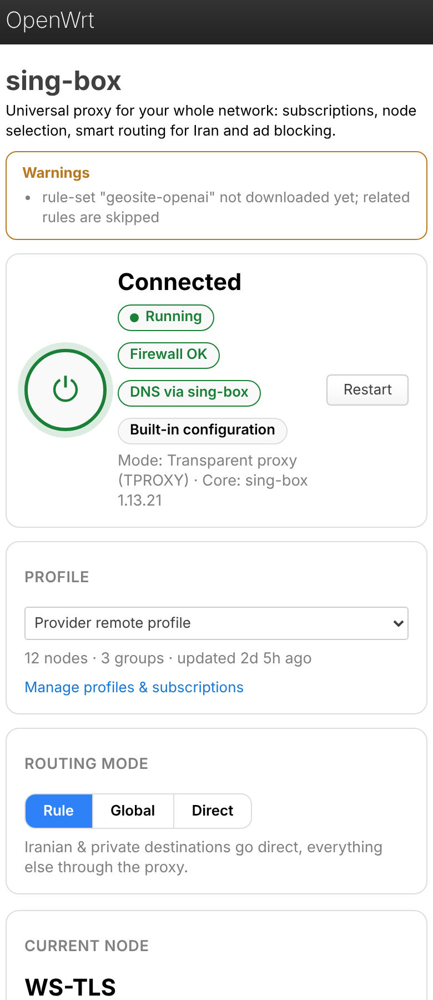

# luci-app-singbox

A full-featured **sing-box** client with a LuCI web interface for **OpenWrt 25.12 and newer**. It runs on any architecture (x86-64, ARM, MIPS, …) and offers what the mobile apps (SFA / Hiddify / v2rayNG) do, applied to your whole network: every device behind the router goes through the proxy with no setup on the device.



## Install

Run this on the router over SSH:

```sh
wget -O /tmp/sb-install.sh https://raw.githubusercontent.com/Danialrostamani/Luci-app-Singbox/main/install.sh && sh /tmp/sb-install.sh
```

Then reload the browser page and open **Services → sing-box**.

The installer does the following:
- installs the required packages (`ucode`, `rpcd-mod-ucode`, `nftables`, `kmod-nft-tproxy`, `kmod-tun`, `curl`, …)
- on a **first installation**, downloads the **latest stable sing-box core** from GitHub. It uses the static musl build that runs on OpenWrt. If GitHub is unreachable, the OpenWrt `sing-box` package is used instead.
- copies the app, creates the firewall zone and enables the service

| Action | Command |
|---|---|
| Install / upgrade (keeps all settings) | `sh /tmp/sb-install.sh` |
| Upgrade from the web interface | **Update** tab → **Update app** |
| Remove the app (keeps settings and data) | `sh /tmp/sb-install.sh uninstall` |
| Remove everything | `sh /tmp/sb-install.sh purge` |
| Download through a GitHub mirror | `GH_PROXY=https://ghfast.top/ sh /tmp/sb-install.sh` |
| Keep the OpenWrt sing-box package as core | `NO_CORE_UPDATE=1 sh /tmp/sb-install.sh` |

**Manual / offline install:** copy `luci-app-singbox.tar.gz` to `/tmp` on the router, then run:

```sh
cd /tmp && mkdir -p sbapp && tar xzf luci-app-singbox.tar.gz -C sbapp && sh sbapp/*/install.sh
```

## Quick start

1. **Profiles → Subscriptions → Add subscription**: paste your subscription link, then **Save & Apply** and **Update now**. To run a complete sing-box configuration instead, use **New profile**.
2. **Overview**: press the power button.
3. **Nodes**: press **Test all**, then tap a node (or **Auto**).

Iranian sites go direct and ads are blocked by default.

## Features

- **Subscriptions** in every common format:
  - base64 and plain share links, “multi” links
  - Clash / Mihomo YAML, sing-box JSON, Xray JSON
  - automatic updates and usage / expiry display
  - include / exclude filters, custom User-Agent
- **Profiles** run complete sing-box configurations, like profiles in the sing-box apps, or any **subscription link** (share links, base64, Clash, Xray JSON) with the built-in routing and DNS:
  - remote profiles (auto-update) or local ones
  - switch with one click, check, export, duplicate
  - adapted for the router automatically; a broken profile falls back to the built-in configuration instead of cutting the network
- **Protocols**:
  - VLESS (Reality, Vision), VMess, Trojan, Shadowsocks (2022, obfs, v2ray-plugin)
  - Hysteria2 (port hopping, salamander), Hysteria, TUIC, AnyTLS, WireGuard, SOCKS, HTTP(S)
  - WireGuard `.conf` files: upload them under Nodes → Add nodes → Upload file (several peers supported; AmneziaWG is not supported by sing-box)
  - transports: WebSocket, gRPC, HTTP/2, HTTPUpgrade, QUIC; uTLS
- **Core choice per subscription / profile**: Auto (sing-box, Xray only where needed), Xray (VLESS / VMess / Trojan / Shadowsocks through Xray), or sing-box only.
- **XHTTP (SplitHTTP), mKCP, VLESS encryption and Xray JSON configs** through an optional **Xray core** that runs next to sing-box. These nodes still behave like normal nodes: switching, Auto, latency tests and routing all work.
- **Mobile-style node picker**:
  - colour-coded latency, **Test all** (also while the service is stopped)
  - switching without restart, **Auto (best)**, search and sort
- **Whole-network transparent proxy**:
  - **TUN** (default, mixed stack), **TPROXY**, or proxy port only
  - optional proxying of the router itself, IPv6, per-device access control, bypass lists
- **Smart routing**:
  - Iran direct and ad blocking with the [sing-box-iran-rules](https://github.com/Danialrostamani/sing-box-iran-rules) rule-sets
  - custom rules (domain, keyword, regex, geosite, geoip, IP, MAC, port, protocol, rule-set)
  - live **Rule / Global / Direct** switch
- **Leak-free DNS**:
  - remote DNS through the proxy (`tcp://1.1.1.1` by default), direct DNS `local`
  - DoH / DoT / DoQ, FakeIP, automatic dnsmasq integration
- **Full speed**:
  - **Maximum performance** mode (default): sing-box uses all CPU cores and the free RAM, packet steering, irqbalance, BBR, larger buffers, flow offloading
  - removes fixed Hysteria2 / Brutal bandwidth caps (BBR), optional multiplex off
- **Core version picker** (Update tab) for sing-box (1.12+) and Xray (24.11+): any release, a pre-release, or the OpenWrt package. The new core is verified before the old one is removed.
- **One-click app updates** from this repository on the **Update** tab (settings, subscriptions, profiles and the chosen core are kept).
- **Speed test** per node: download / upload in Mbps, through a temporary instance, also while the service is stopped.
- **Devices & traffic**: live speed and traffic per LAN device (Connections page), speed chart of the last minutes on the overview, live CPU of sing-box, Xray and the router.
- **Quick rules**: one click for Telegram, Instagram / WhatsApp / Facebook, YouTube & Google, X, AI services, Netflix & Spotify via proxy, torrents or online games direct.
- **Backup & restore**: all settings, subscriptions and local profiles in one file (Update tab).
- **Telegram notifications**: service stopped, proxy unreachable, data almost used up, subscription expiring; sent through the proxy, with a test button.
- **Memory use** setting: Balanced (default), Maximum or Low.
- **Dashboard**:
  - live speed in KB/s, connections, memory
  - logs with an on/off switch
  - generated config preview, `sing-box check`, custom config mode
- **Robust**:
  - version-aware config generation (sing-box 1.12 → 1.14+)
  - broken nodes are skipped automatically
  - fail-open watchdog: the LAN keeps internet if the core stops
- Dark mode and mobile-friendly layout. English UI.

## Requirements

- **OpenWrt 25.12 or newer** (apk). 24.10 (opkg) also works.
- **Any architecture**: the app is pure ucode + JavaScript. The sing-box core comes from GitHub (matching build for your CPU) or the OpenWrt package feed.
- **RAM:** at least 256 MB recommended (the core uses roughly 40–150 MB with the Iran / ad-block rule-sets). **Storage:** 128 MB free recommended (the core binary is about 30–45 MB).

## Xray core (XHTTP / mKCP)

sing-box has no XHTTP, mKCP or VLESS encryption. Nodes that need them run through Xray. Install it once on the **Update** tab (Xray core) (official build or the `xray-core` package) or with:

```sh
singbox-ctl xray-install latest
```

If your panel leaves XHTTP / mKCP nodes out of the subscription, set the subscription's User-Agent to **v2rayNG**. Panels often omit these nodes from sing-box and Clash output.

## Pre-installed in your firmware (OpenWrt Firmware Selector)

The [Firmware Selector](https://firmware-selector.openwrt.org/) only bundles official packages, but it can install this app automatically on the first boot. Open **Customize installed packages and/or first boot script**, then:

1. Add to the **package list**:
   ```
   curl ca-bundle ucode ucode-mod-fs ucode-mod-uci ucode-mod-ubus rpcd-mod-ucode nftables kmod-nft-tproxy kmod-nft-fib kmod-tun ip-full luci kmod-tcp-bbr irqbalance
   ```
   Add `xray-core` too if you use XHTTP / mKCP nodes.

2. Put this in **Script to run on first boot (uci-defaults)**. Once the router is online, it installs the app (with the latest sing-box core) and then removes itself:
   ```sh
   cat > /usr/bin/sbapp-firstboot <<'EOS'
   #!/bin/sh
   n=0
   while [ $n -lt 120 ]; do
   	if wget -q -T 30 -O /tmp/sb-install.sh https://raw.githubusercontent.com/Danialrostamani/Luci-app-Singbox/main/install.sh && sh /tmp/sb-install.sh; then
   		sed -i '/sbapp-firstboot/d' /etc/rc.local
   		rm -f /usr/bin/sbapp-firstboot /tmp/sb-install.sh
   		exit 0
   	fi
   	n=$((n + 1))
   	sleep 30
   done
   EOS
   chmod +x /usr/bin/sbapp-firstboot
   if ! grep -q sbapp-firstboot /etc/rc.local; then
   	if grep -q '^exit 0' /etc/rc.local; then
   		sed -i '/^exit 0/i /usr/bin/sbapp-firstboot >/tmp/sbapp-firstboot.log 2>&1 &' /etc/rc.local
   	else
   		echo '/usr/bin/sbapp-firstboot >/tmp/sbapp-firstboot.log 2>&1 &' >> /etc/rc.local
   	fi
   fi
   exit 0
   ```

A minute or two after the first boot with internet, **Services → sing-box** appears. If it doesn't, the log is in `/tmp/sbapp-firstboot.log`.

## Tips

- **Speed:** keep **Settings → Performance → Maximum performance** and **Bandwidth limits → Remove limits** on. On weak ARM routers, VLESS-Reality is lighter than QUIC-based protocols.
- **NAT type for games / calls:** connect Wi-Fi access points in **access point mode** (no NAT of their own). A second router doing NAT behind OpenWrt limits UDP NAT to “port restricted”.
- **GitHub slow or blocked:** set a mirror under **Routing → GitHub mirror** (e.g. `https://ghfast.top/`).
- Remove custom upstream servers under **Network → DHCP and DNS → Forwards**, or they bypass sing-box DNS.

## Command line

```sh
singbox-ctl status                  # service and core status
singbox-ctl app-check               # is a newer version of the app on GitHub?
singbox-ctl app-update              # update the app
singbox-ctl sub-update all          # update subscriptions
singbox-ctl core-update latest      # install the latest sing-box core (or a version, e.g. 1.13.6)
singbox-ctl xray-install latest     # install the Xray core
$(singbox-ctl core-path) version    # core version in use
logread -e sing-box | tail -50      # logs
```

## Screenshots

| Nodes | Profiles |
|---|---|
|  |  |

| Settings → Performance | Mobile |
|---|---|
|  |  |

---

## راهنمای فارسی

**نصب** (در SSH روتر):

```sh
wget -O /tmp/sb-install.sh https://raw.githubusercontent.com/Danialrostamani/Luci-app-Singbox/main/install.sh && sh /tmp/sb-install.sh
```

بعد صفحهٔ مرورگر را رفرش کنید و به **Services ← sing-box** بروید. نصب اول، آخرین نسخهٔ پایدار هستهٔ sing-box را هم از GitHub نصب می‌کند.

- **آپدیت:** از داخل برنامه: سربرگ **Update** ← **Update app**. یا همان دستور نصب را دوباره بزنید. تنظیمات حفظ می‌شوند.
- **حذف:** `sh /tmp/sb-install.sh uninstall`
- **حذف کامل همراه با تنظیمات:** `sh /tmp/sb-install.sh purge`
- **اگر GitHub کند است:** `GH_PROXY=https://ghfast.top/ sh /tmp/sb-install.sh`

**شروع سریع:**
1. در **Profiles ← Subscriptions** لینک ساب را اضافه کنید و **Update now** بزنید.
2. در **Overview** دکمهٔ روشن را بزنید.
3. در **Nodes** گزینهٔ **Test all** را بزنید و یک نود (یا Auto) را انتخاب کنید.

**نودهای XHTTP و mKCP:** هستهٔ Xray را از سربرگ **Update** نصب کنید. User-Agent ساب را روی **v2rayNG** بگذارید.

**نصب خودکار داخل فرم‌ور:** بخش «Pre-installed in your firmware» بالا را ببینید. لیست پکیج‌ها و اسکریپت first boot را در Firmware Selector وارد کنید.

## Author

**Danial Rostamani** · Telegram: [t.me/Drostamani](https://t.me/Drostamani)

## License

© 2026 Danial Rostamani. All rights reserved.

You may **download, install and use** luci-app-singbox free of charge on any number of devices. You may **not** copy, redistribute, modify or publish changed versions, or remove the author's credits, without written permission. See [LICENSE](LICENSE). For permissions, contact the author on Telegram.

sing-box, Xray and the other programs the app downloads are separate works under their own licenses.
